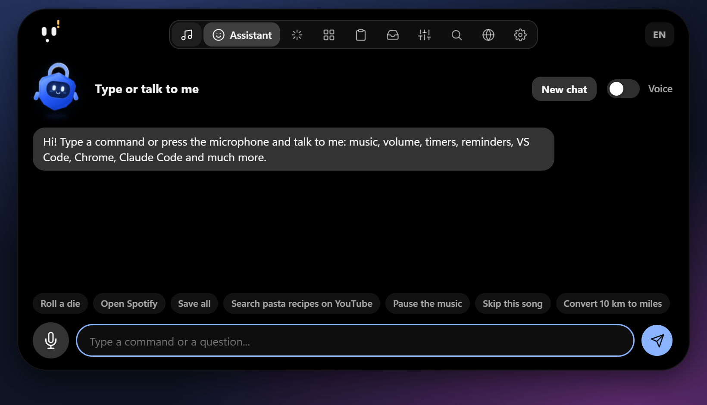
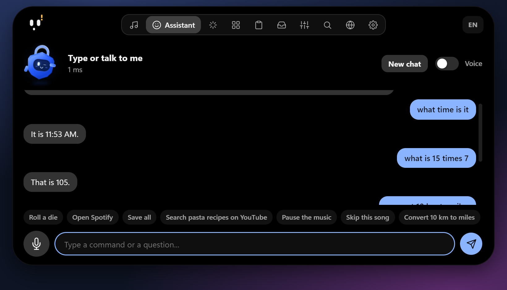
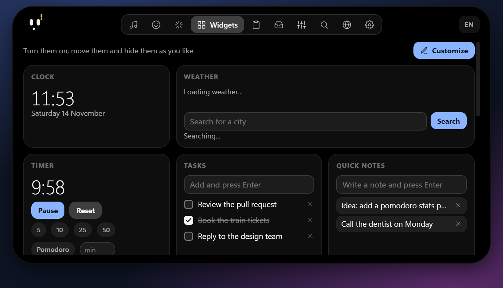
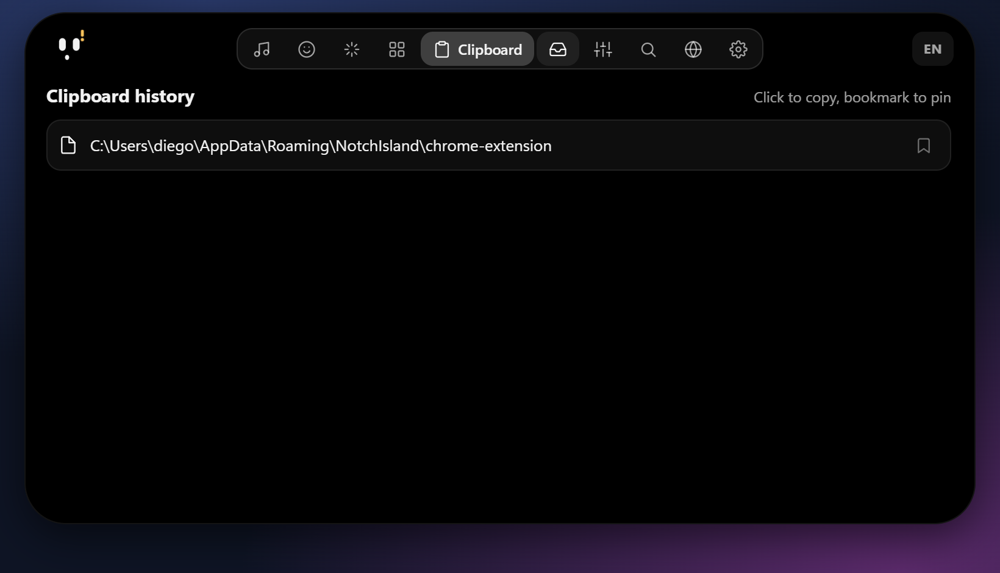
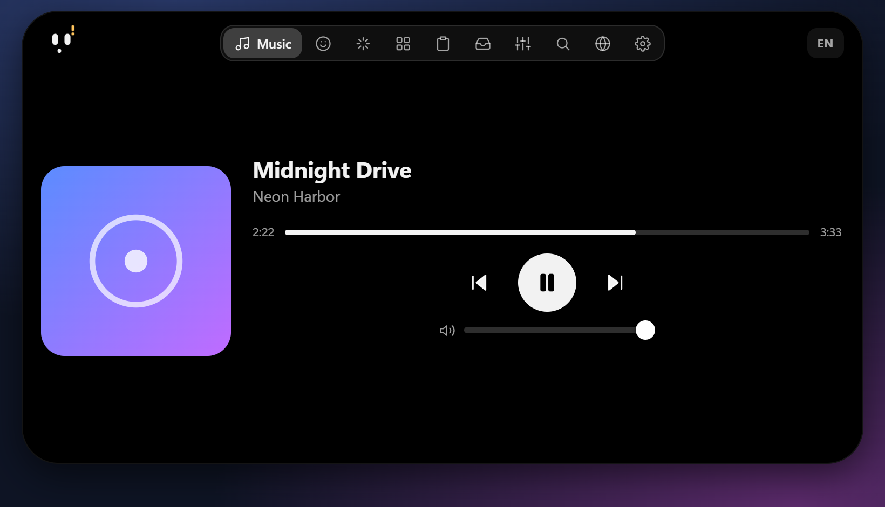

<div align="center">

# NotchIsland

**Una Dynamic Island per Windows con una faccina, che ti ascolta e parla con Claude Code.**

[Sito web](https://notch-island.pages.dev) · [English](README.md) · [Italiano](README.it.md)



</div>

Una piccola pillola resta in alto sullo schermo. Passaci sopra con il mouse e si apre in un centro di controllo: musica, assistente vocale, sessioni di Claude Code, 15 widget, controlli di sistema, cronologia appunti e altro. Sulla pillola vive una **faccina**: gli occhi seguono il mouse, sorride con la musica, si addormenta se non la usi e si mette in allerta quando **Claude ti sta aspettando**.

<div align="center"></div>

## Cosa fa

| | |
|---|---|
| **Una faccina che reagisce** | Gli occhi seguono il cursore, sbatte le palpebre, dorme, si rallegra con la musica, "pensa" mentre Claude lavora, si allarma quando Claude ha bisogno di te, ascolta mentre parli. |
| **Assistente a voce e testo** | Di' o scrivi cosa vuoi: *"metti in pausa la musica"*, *"volume al 40"*, *"timer 10 minuti"*, *"ricordami di chiamare Marco tra 20 minuti"*, *"quanto fa 15 per 7"*, *"apri la cartella del progetto in VS Code"*. Circa 60 azioni integrate in italiano e inglese. |
| **Modalità agente (Claude Code)** | Quello che l'assistente non conosce passa a una vera sessione di **Claude Code**, che può eseguire comandi e modificare file sul tuo PC. Usa **il tuo accesso a Claude tramite la CLI `claude`: nessuna chiave API, nessun costo a consumo**. La chat continua tra una richiesta e l'altra, mostra ogni passaggio in diretta e ha il tasto Stop. |
| **Claude Code, VS Code, Chrome** | Vedi le sessioni di Claude Code in tempo reale (al lavoro / ti aspetta / finito) con una notifica di Windows. Accetta o rifiuta le modifiche proposte dall'isola. Controlli VS Code (salva tutto, terminale, cerca nei file, apri Claude) e Chrome (schede, pausa video, silenzia, riassumi pagina). |
| **15 widget** | Orologio, meteo con previsioni, timer e pomodoro, cronometro, attività, note, promemoria, calendario, monitor di sistema, calcolatrice, collegamenti, orari nel mondo, convertitore, respirazione, dado. Si attivano, nascondono e riordinano. |
| **Musica che funziona** | In riproduzione da qualunque app (Spotify, browser...), copertina, testi sincronizzati, play/pausa, **skip**, precedente, barra cliccabile per spostarsi nel brano, volume. |
| **Personalizzabile** | 5 temi, 8 colori d'accento, modalità fluttuante o notch, dimensione, arrotondamento, apertura al passaggio o al clic, schede e widget visibili, ogni scorciatoia. |
| **Locale e privato** | Il riconoscimento vocale gira sul tuo PC (whisper.cpp). NotchIsland non invia i tuoi dati a nessuno ([dettagli](#privacy-e-sicurezza)). |

## Screenshot

<table>
<tr>
<td><br><sub><b>Assistente</b> — scrivi o parla, l'avatar reagisce.</sub></td>
<td><br><sub><b>Claude</b> — sessioni in diretta, VS Code e Chrome.</sub></td>
</tr>
<tr>
<td><br><sub><b>Widget</b> — meteo, timer, attività, note e altri 11.</sub></td>
<td><br><sub><b>Impostazioni</b> — lingua, tema, faccina, schede, scorciatoie.</sub></td>
</tr>
</table>

## Installazione

**Da release** — scarica `NotchIsland-Setup-x.y.z.exe` dalla pagina [Releases](../../releases) ed eseguilo. Si installa per utente (senza permessi di amministratore) e parte con Windows. L'installer non è firmato: SmartScreen può chiederti conferma.

**Dai sorgenti**

```bash
git clone https://github.com/diegobruvhrpiugvjrigjtibjte/notch-island.git
cd notch-island
npm install
npm start          # sviluppo
npm run dist       # crea l'installer in dist/
```

> Se lo avvii dal terminale di VS Code, assicurati che la variabile `ELECTRON_RUN_AS_NODE` non sia impostata.

## Primi passi

1. **Passa con il mouse sulla pillola** in alto (o `Ctrl+Alt+N`) e scegli una scheda.
2. **Parlaci**: `Ctrl+Alt+Spazio`, oppure scheda Assistente e microfono. La prima volta propone di scaricare il riconoscimento vocale locale (circa 190 MB, una volta sola, con verifica del checksum). Scrivere funziona sempre.
3. **Collega Claude Code** (scheda Claude → *Collega*): aggiunge alcuni hook a `~/.claude/settings.json` (resta una copia `.notch-backup`; *Scollega* li toglie). Le sessioni già aperte vanno riavviate.
4. **Collega VS Code** (*Installa estensione*) e ricarica la finestra di VS Code.
5. **Collega Chrome** (*Prepara estensione*): copia l'estensione in una cartella e apre `chrome://extensions`; attiva *Modalità sviluppatore* → *Carica estensione non pacchettizzata* e incolla il percorso (è già negli appunti).

## L'assistente

Capisce italiano e inglese insieme. Esempi: *metti in pausa la musica · salta questa canzone · volume al 40 · muta il microfono · fai uno screenshot · blocca il pc · timer 10 minuti · pomodoro · ricordami di bere tra 30 minuti · prendi nota: idee per la demo · quanto fa 15 per 7 · converti 10 km in miglia · tira un dado · che tempo fa a Roma · apri Spotify · cerca ricette di pasta su YouTube · salva tutto (VS Code) · nuova scheda (Chrome) · stato di Claude · accetta le modifiche · traduci buongiorno in inglese*.

### Modalità agente

Se l'assistente non riconosce la richiesta, avvia una **nuova sessione di Claude Code** con la riga di comando `claude`. La sessione può usare il terminale, leggere e modificare file e navigare sul web: *"crea un file di testo sul desktop con la data di oggi"*, *"trova i tre file più grandi in Download"*.

* **Nessuna chiave API, nessun costo extra**: `ANTHROPIC_API_KEY` viene tolta dall'ambiente del processo, quindi usa l'account con cui hai fatto l'accesso (il tuo piano Claude, con i suoi limiti d'uso).
* **Ricorda**: *"ora cancella quel file"* continua la stessa conversazione (per 20 minuti). *Nuova chat* riparte da zero.
* **Vedi tutto**: ogni comando (`Bash: ...`, `Edit: ...`) compare in diretta e puoi fermarlo con un clic.
* **Protezioni**: i comandi distruttivi (`rm -rf`, `del /s`, `format`, `shutdown`, `reg delete`, `git push --force`...) sono bloccati e a Claude viene chiesto di confermare prima di azioni irreversibili. È una rete di sicurezza, non una sandbox: puoi scegliere **Solo legge** o **Spento** in Impostazioni → Assistente.

## Lingue

L'interfaccia è in **Italiano** e **English** e segue la lingua del sistema. Cambia con il pulsante `IT/EN` in alto a destra o da Impostazioni → Lingua; assistente e riconoscimento vocale seguono. Aggiungere una lingua è un file solo: vedi [CONTRIBUTING.md](CONTRIBUTING.md).

## Privacy e sicurezza

* La voce è riconosciuta **in locale** con [whisper.cpp](https://github.com/ggml-org/whisper.cpp) (programma e modello scaricati una volta, con SHA-256 verificato). L'audio non esce dal PC.
* Richieste di rete: meteo a [Open-Meteo](https://open-meteo.com), copertine all'API iTunes Search (artista e titolo del brano), testi a [lrclib](https://lrclib.net), e il download della voce (GitHub, Hugging Face). Le funzioni Claude passano dalla tua installazione di `claude`, con il tuo account.
* I tuoi dati (attività, note, promemoria, impostazioni) restano in `%APPDATA%\NotchIsland`.
* L'hub locale che collega Claude Code, VS Code e Chrome ascolta solo su `127.0.0.1`, richiede un token segreto, respinge le pagine web e dà il token all'estensione Chrome solo tramite un'intestazione che le pagine non possono inviare. I comandi per VS Code sono limitati a un elenco consentito.

## Test e sviluppo

`node test/brain.test.js`, `executor.test.js`, `calc.test.js`, `voice.test.js`, `hub.test.js` (veloci), `vscode.e2e.js`, `chrome.e2e.js`, `app.e2e.js` (usano VS Code, Chrome e l'app veri), `agent.test.js` (agente Claude Code reale). L'architettura è descritta nel [README inglese](README.md#how-it-works).

## Limiti noti

Solo Windows 10/11; installer non firmato; la qualità del riconoscimento dipende dal modello e dal microfono; gli hook di Claude Code si leggono all'avvio della sessione; la luminosità richiede un monitor con DDC/CI (o un portatile).

## Crediti e licenza

Codice: [MIT](LICENSE). Usa whisper.cpp (MIT), Open-Meteo, lrclib, `ws`, `qrcode`. L'avatar blu a forma di lucchetto nella scheda Assistente è un'opera di **Vault Semplice** e **non** è coperto dalla licenza MIT ([NOTICE](NOTICE)).

Progetto indipendente, non affiliato né approvato da Anthropic. *Claude* e *Claude Code* sono marchi di Anthropic.
