<div align="center">

# NotchIsland

**A Dynamic Island for Windows that has a face, listens to you, and talks to Claude Code.**

[](#install)
[](https://www.electronjs.org)
[](LICENSE)
[](#languages)

[Website](https://notch-island.pages.dev) · [English](README.md) · [Italiano](README.it.md) · **[Website & live demo](https://notch-island.lacarbonaradiego37.workers.dev)**

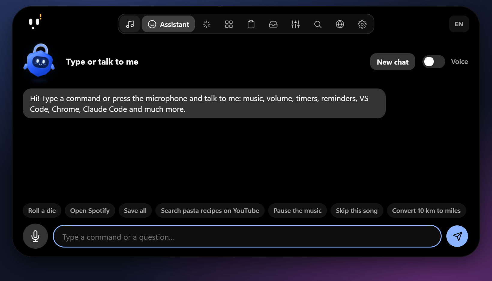

</div>

A small pill sits at the top of your screen. Hover it and it opens into a control center: music, a voice assistant, your Claude Code sessions, 15 widgets, system controls, clipboard history and more. A little face lives on the pill: its eyes follow your mouse, it smiles with the music, it falls asleep when you are idle, and it turns alert when **Claude is waiting for you**.

<div align="center">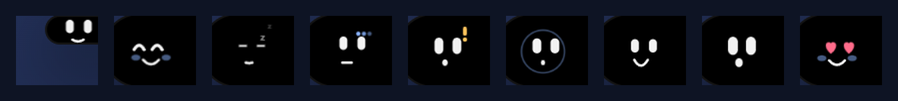</div>

## Highlights

| | |
|---|---|
| **A face that reacts** | Eyes follow the cursor, blinks, sleeps, gets happy with music, thinks while Claude works, is alerted when Claude needs you, listens while you talk. Click it for a surprise (click it five times for a bigger one). |
| **Voice and text assistant** | Say or type what you want: *"pause the music"*, *"volume 40"*, *"timer 10 minutes"*, *"remind me to call Mark in 20 minutes"*, *"what is 15 times 7"*, *"open the project folder in VS Code"*. About 60 built-in actions in English and Italian. |
| **Agent mode (Claude Code)** | Anything the assistant does not know is handed to a real **Claude Code** session that can run commands and edit files on your PC. It uses **your own Claude login through the `claude` CLI, no API key and no per-token billing**. The chat continues across requests, shows every step live, and has a Stop button. |
| **Claude Code, VS Code, Chrome** | See your Claude Code sessions live (working / waiting for you / done) with a Windows notification when Claude needs you. Accept or reject proposed diffs from the island. Control VS Code (save all, terminal, search in files, open Claude) and Chrome (tabs, pause video, mute, summarize page). |
| **15 widgets** | Clock, weather with forecast, timer + pomodoro, stopwatch, tasks, notes, reminders, calendar, system monitor, calculator, links, world clocks, unit converter, breathing, dice. Turn on, hide and reorder them. |
| **Music that works** | Now playing from any app (Spotify, browsers, ...), cover art, synced lyrics, play/pause, **skip**, previous, a seekable progress bar and volume. |
| **Fully customizable** | Choose which monitor shows the pill, 5 themes (black, graphite, midnight, light, auto), 8 accent colors, floating or notch mode, size, roundness, hover or click to open, which tabs and widgets you see, every shortcut. |
| **Local and private** | Speech recognition runs on your PC (whisper.cpp). Nothing about your data is sent anywhere by NotchIsland itself ([details](#privacy-and-security)). |

## Screenshots

<table>
<tr>
<td>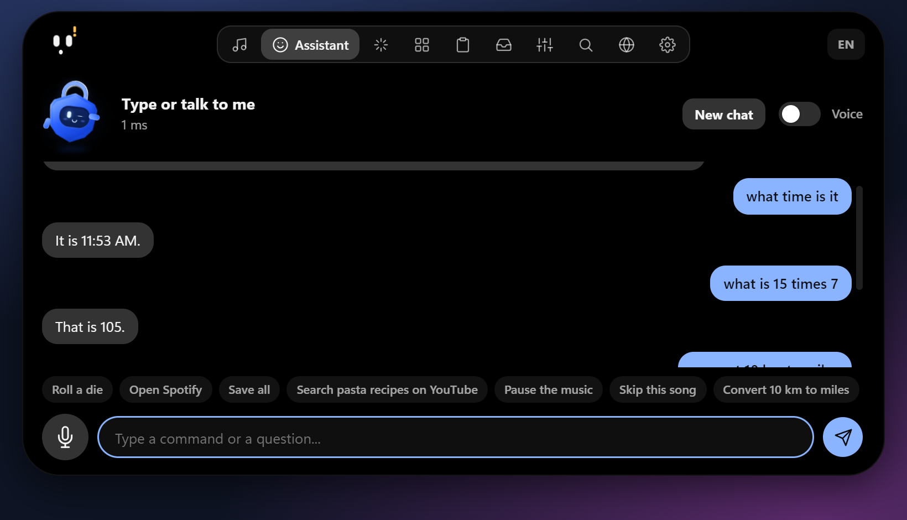<br><sub><b>Assistant</b> — type or talk, answers in your language, avatar reacts.</sub></td>
<td>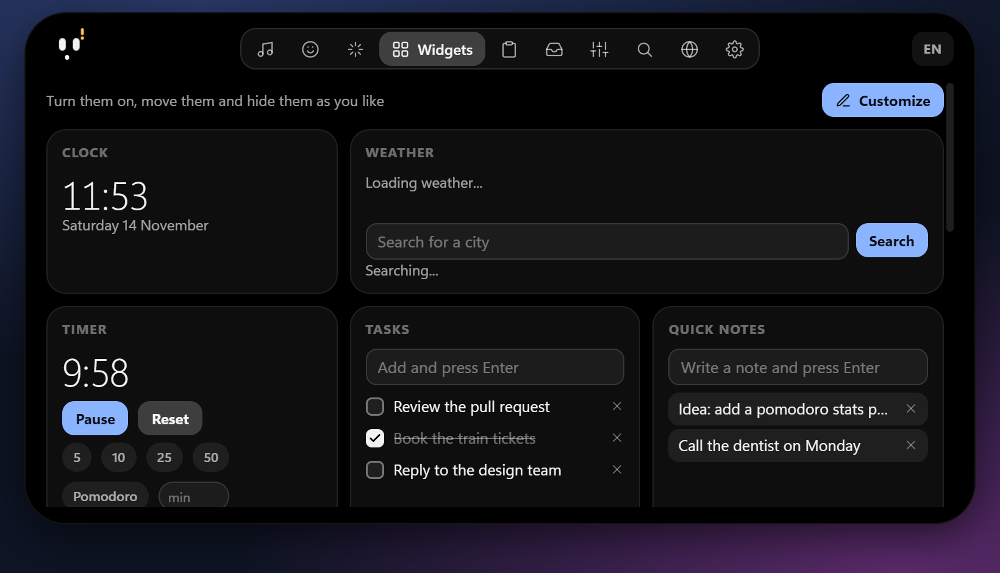<br><sub><b>Claude</b> — live sessions, VS Code and Chrome links.</sub></td>
</tr>
<tr>
<td>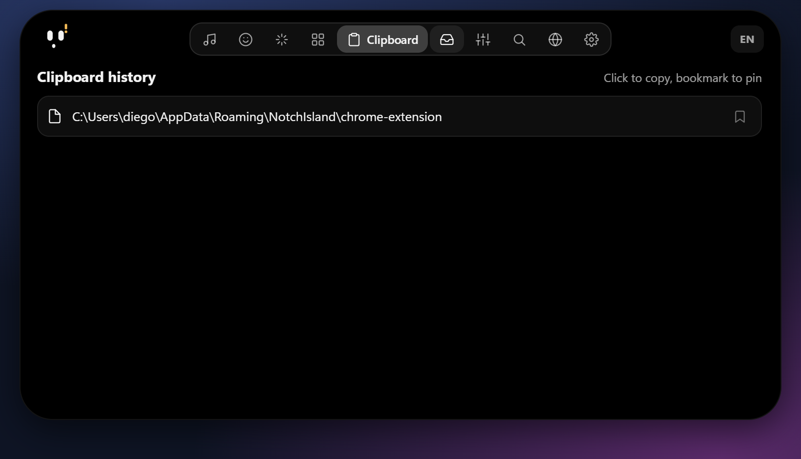<br><sub><b>Widgets</b> — weather, timer, tasks, notes and 11 more.</sub></td>
<td>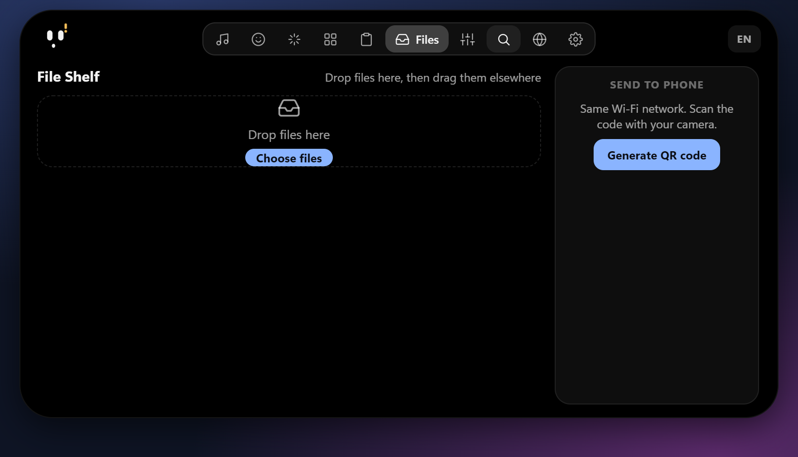<br><sub>System monitor, calendar, calculator, reminders...</sub></td>
</tr>
<tr>
<td>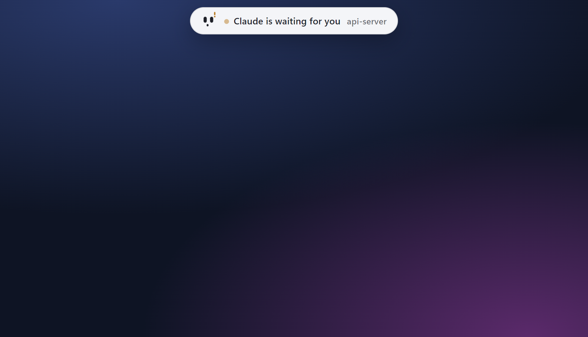<br><sub>Light theme with a pink accent.</sub></td>
<td>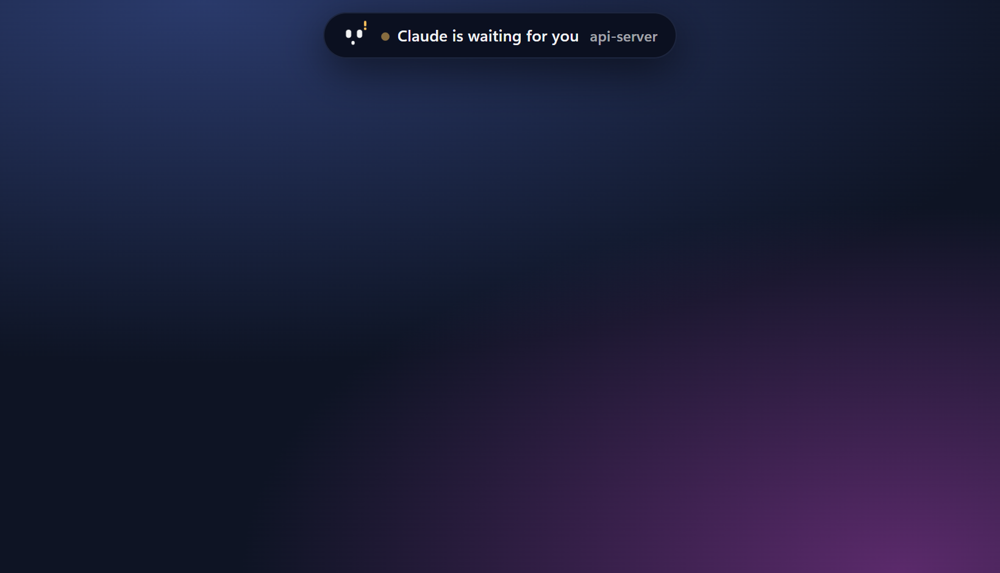<br><sub>Midnight theme with a violet accent.</sub></td>
</tr>
<tr>
<td>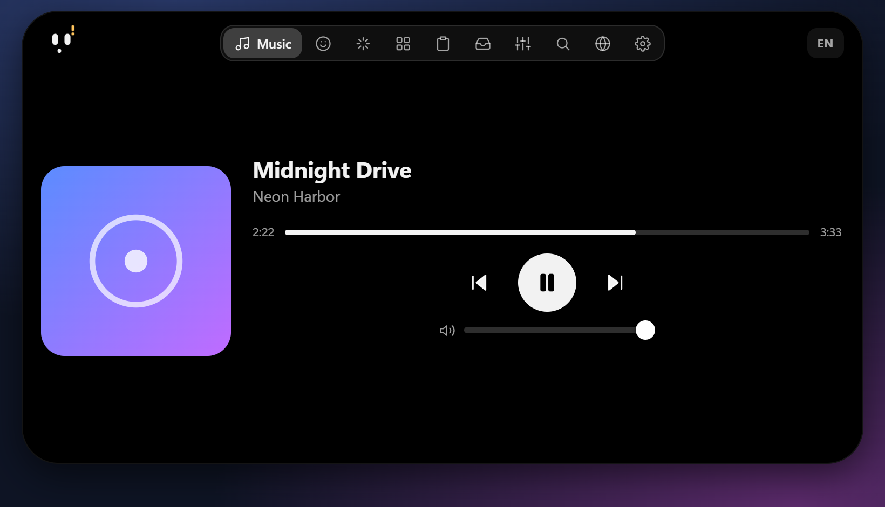<br><sub><b>Settings</b> — language, theme, face, tabs, shortcuts.</sub></td>
<td>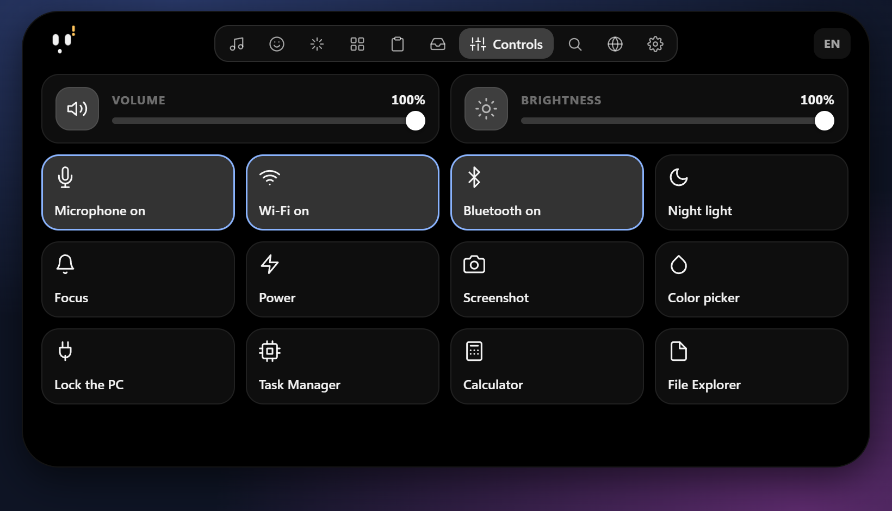<br><sub><b>Controls</b> — volume, brightness, mic, Wi-Fi, Bluetooth, shortcuts.</sub></td>
</tr>
</table>

The closed pill adapts to what matters right now:

<div align="center">
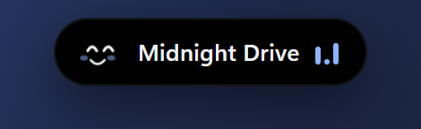 &nbsp; 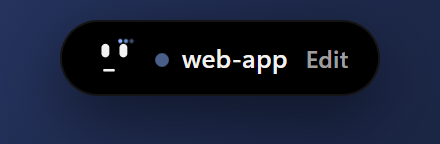 &nbsp; 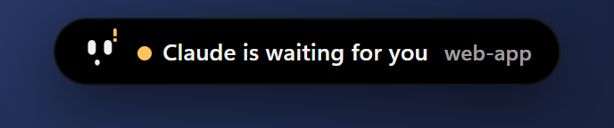<br>
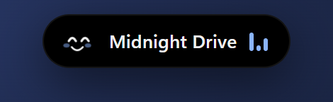 &nbsp; 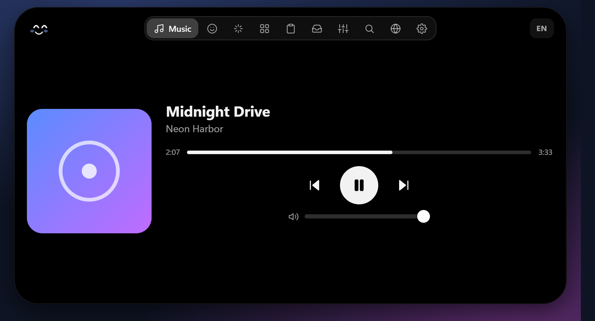 &nbsp; 
</div>

## Install

**From a release** — download `NotchIsland-Setup-x.y.z.exe` from the [website](https://notch-island.lacarbonaradiego37.workers.dev) or the [Releases](../../releases) page and run it. A custom animated installer (English/Italian) lets you choose autostart, a desktop shortcut and the app language; it installs per user, no admin rights. The installer is not code-signed, so Windows SmartScreen may ask you to confirm.

**From source**

```bash
git clone https://github.com/diegobruvhrpiugvjrigjtibjte/notch-island.git
cd notch-island
npm install
npm start              # run in development
npm run build:installer   # build the custom installer into dist/ (needs Windows)
```

> If you start it from VS Code's terminal, make sure the `ELECTRON_RUN_AS_NODE` variable is not set (VS Code sets it).

## Getting started

1. **Hover the pill** at the top of the screen (or press `Ctrl+Alt+N`). Click a tab.
2. **Talk to it**: press `Ctrl+Alt+Space`, or open the Assistant tab and click the microphone. The first time it offers to download the local speech recognition (about 190 MB, once, checksum verified). Typing always works without it.
3. **Connect Claude Code** (Claude tab → *Connect*): adds a few hooks to `~/.claude/settings.json` (a `.notch-backup` copy is kept; *Disconnect* removes them). New Claude Code sessions then show up live. Sessions that were already open need a restart to start reporting.
4. **Connect VS Code** (Claude tab → *Install extension*) and reload the VS Code window.
5. **Connect Chrome** (Claude tab → *Prepare extension*): copies the extension to a folder and opens `chrome://extensions`; enable *Developer mode* → *Load unpacked* → paste the folder path (it is already in your clipboard).

## The assistant

Type or say any of these (English and Italian are understood side by side):

| Area | Examples |
|---|---|
| Music | *pause the music · skip this song · previous song · what is this song* |
| Sound & screen | *volume 40 · turn up the volume · mute · brightness 60 · mute the microphone · turn off Wi-Fi · take a screenshot · lock the PC* |
| Time | *timer 10 minutes · pomodoro · start the stopwatch · remind me to drink water in 30 minutes · what time is it · what day is it* |
| Notes | *take a note: ideas for the demo · add task: pay the invoice · what do I have to do · read my notes · read my clipboard* |
| Math & fun | *what is 15 times 7 · what is 20% of 150 · convert 10 km to miles · roll a die · flip a coin · tell me a joke · translate good morning to Spanish* |
| Info | *what is the weather in London · how is my PC · battery level* |
| Apps & web | *open Spotify · open the calculator · search pasta recipes on YouTube · go to github.com · open the downloads folder* |
| VS Code | *save all · new terminal · format the file · show problems · find useState in files · run npm test in the terminal · open the folder my-project* |
| Chrome | *new tab · close the tab · reload · list tabs · switch to the YouTube tab · pause the video · mute the tabs · summarize this page* |
| Claude Code | *Claude status · accept the changes · reject the changes · new conversation · ask Claude: how do I revert a commit* |
| The island | *show the widgets · switch theme to light · hide the face* |
| Anything else | Handed to Claude Code (agent mode, below). |

### Agent mode: Claude Code does the work

When the assistant does not recognize a request, it starts a **new Claude Code session** using the `claude` command line that comes with Claude Code. That session can use the terminal, read and edit files and browse the web, so you can say things like *"create a text file on my desktop with today's date"*, *"find the three biggest files in Downloads"* or *"set up a .gitignore for this folder"*.

* **No API key, no extra cost.** `ANTHROPIC_API_KEY` is removed from the environment of the child process, so it uses the account you are logged in with (your Claude plan, subject to its usage limits).
* **It remembers.** Follow-ups like *"now delete that file"* continue the same conversation (for 20 minutes). Use *New chat* to start over.
* **You see everything.** Each tool call (`Bash: ...`, `Edit: ...`) appears live in the chat and you can stop it with one click.
* **Guard rails.** Destructive commands (`rm -rf`, `del /s`, `format`, `shutdown`, `reg delete`, `git push --force`, ...) are blocked, and the system prompt asks Claude to confirm before irreversible actions. This is a safety net, not a sandbox: in *Acts on the PC* mode the agent can run other commands. If you prefer, choose **Read only** or **Off** in Settings → Assistant.

## Customization

Everything is in **Settings** (the gear tab): language, theme, accent color, floating or notch position, pill size and roundness, open on hover or on click, the face (and whether it sleeps), what the closed pill shows, visible tabs, assistant behavior, notifications, sounds and every global shortcut (click a shortcut and press the new keys). Widgets are chosen and reordered from the Widgets tab with **Customize**.

Default shortcuts: `Ctrl+Alt+N` open/close · `Ctrl+Alt+Space` talk · `Ctrl+Alt+P` play/pause · `Ctrl+Alt+M` mic · `Ctrl+Alt+S` screenshot · `Ctrl+Alt+C` color picker · `Ctrl+Alt+H` hide.

## Languages

The interface is available in **English** and **Italiano** and follows your system language by default. Change it with the `IT/EN` button at the top right of the island or in Settings → Language; the assistant and speech recognition follow.

Adding a language is one file: copy [`src/i18n/en.js`](src/i18n/en.js) to `src/i18n/xx.js`, translate the values, and add `['xx', 'Name']` to `LANGS` in [`src/i18n/core.js`](src/i18n/core.js). See [CONTRIBUTING.md](CONTRIBUTING.md).

## Privacy and security

* **Speech** is recognized locally with [whisper.cpp](https://github.com/ggml-org/whisper.cpp). The program and the `small` model are downloaded once and verified against pinned SHA-256 checksums. Audio never leaves your PC.
* **Network requests made by the app:** weather and city search to [Open-Meteo](https://open-meteo.com), cover art to the iTunes Search API (artist and title of the current track), synced lyrics to [lrclib](https://lrclib.net) (same), and the one-time voice download from GitHub and Hugging Face. The Claude features run through your own `claude` installation, under your own account.
* **Your data** (tasks, notes, reminders, links, settings) is stored in `%APPDATA%\NotchIsland` and nowhere else.
* **The local hub** that connects Claude Code, VS Code and Chrome listens on `127.0.0.1` only, requires a random secret token on every request, rejects browser pages (Origin check) and only hands the token to the Chrome extension through a header web pages cannot send. VS Code commands are limited to an allow-list; running a command in the VS Code terminal needs your confirmation inside VS Code.
* The Claude Code hooks send events (session id, folder, tool names and paths) **to that local hub only**.

## How it works

```
 you ── mouse / keyboard / mic ──► island (Electron renderer: face, tabs, widgets, assistant UI)
                                      │  IPC
                                      ▼
                                main process ──► brain (intents) ──► executor ──► Windows (PowerShell agents),
                                      │                                │          apps, files, web
                                      │                                └────────► Claude Code agent (`claude -p`, your login)
                                      ▼
                                local hub 127.0.0.1 ◄── Claude Code hooks (curl)
                                      ▲   ▲
                    VS Code extension ┘   └ Chrome extension (MV3)
```

| Path | What it is |
|---|---|
| `src/main.js` | Window, IPC, hit-testing, shortcuts, reminders, hub start-up |
| `src/brain.js` · `src/executor.js` | English/Italian intent parser and the code that performs each intent |
| `src/claude.js` | Hooks installer, `claude` discovery, one-shot ask and the streaming agent |
| `src/hub.js` | Local HTTP + WebSocket hub (hooks, VS Code, Chrome) |
| `src/voice.js` | whisper.cpp download, verification and transcription |
| `src/agents/*.ps1` | Two persistent PowerShell agents: volume, mic, brightness, radios, media session (SMTC), apps, system monitor |
| `src/island/` | UI: `face.js`, `avatar.js`, `widgets.js`, `assistant.js`, `claudeui.js`, `settings.js`, `i18n.js` |
| `integrations/` | The VS Code extension (`.vsix`) and the Chrome extension |
| `installer/` | The custom setup program (C#, GDI+) that wraps the silent engine |
| `site/` | The website (static page + Cloudflare Worker) |

## Tests

```bash
node test/brain.test.js      # intent parser
node test/executor.test.js   # every intent -> the right action (mocked system)
node test/calc.test.js       # calculator and unit conversion
node test/voice.test.js      # WAV encoding, text clean-up, archive extraction
node test/hub.test.js        # hub, hooks, security, installer of the hooks (temp HOME)
node test/vscode.e2e.js      # real VS Code in an isolated profile
node test/chrome.e2e.js      # real Chrome with the extension loaded
node test/app.e2e.js         # the whole app driven over CDP (fake microphone included)
node test/hover.e2e.js       # real mouse cursor: opens on hover, closes on leave
node test/display.e2e.js     # multi-monitor: choose which screen shows the pill
node test/apps.test.js       # natural phrases -> the right installed app
node test/agent.test.js      # real Claude Code agent (uses a few requests of your plan)
```

The end-to-end tests drive real applications on a Windows machine. `npm run docs:screenshots` regenerates the screenshots with demo data.

## Known limitations

* Windows 10/11 only (the system agents are PowerShell/WinRT). macOS and Linux are not supported yet.
* The installer is unsigned.
* Recognition quality depends on the whisper model and your microphone; the first transcription after install is slower.
* Claude Code hooks are read when a session starts: restart already-open sessions after pressing *Connect*.
* Brightness control needs a display that exposes DDC/CI (or a laptop panel).

## Credits and license

Code: [MIT](LICENSE). Uses [whisper.cpp](https://github.com/ggml-org/whisper.cpp) (MIT), [Open-Meteo](https://open-meteo.com), [lrclib](https://lrclib.net), [`ws`](https://github.com/websockets/ws) and [`qrcode`](https://github.com/soldair/node-qrcode). The blue lock avatar in the Assistant tab is artwork from **Vault Semplice** and is **not** covered by the MIT license (see [NOTICE](NOTICE)).

NotchIsland is an independent project and is not affiliated with or endorsed by Anthropic. *Claude* and *Claude Code* are trademarks of Anthropic.
